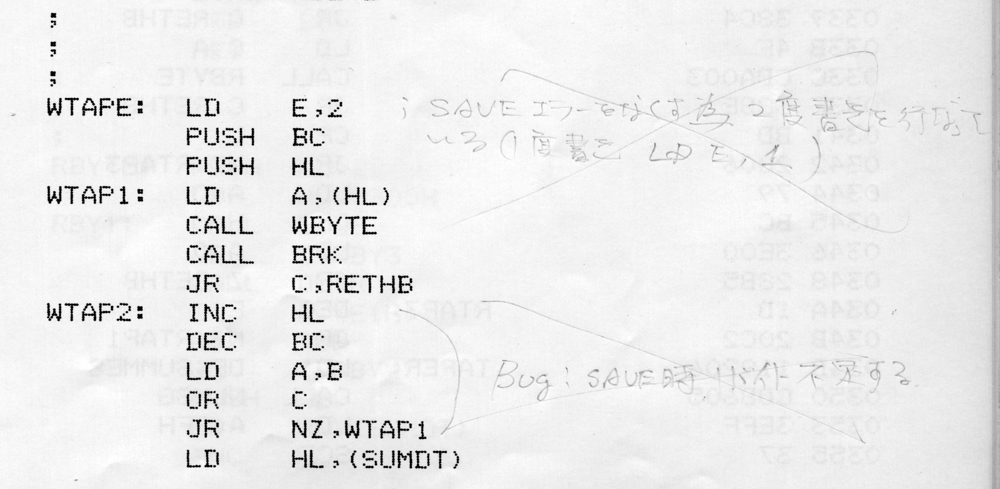

# Sharp MZ-80B Monitor SB-1520: program listing

Introduction<br>
This manual describes the commands and subroutines of MONITOR SB-1520, the standard system software for the MZ-80B personal computer. It shows how to write programs and set up data in machine language.<br>
MONITOR SB-1520 is the standard monitor program in the MZ-80B system software. Its main job is to support the BASIC interpreter SB-5520, the DISK BASIC interpreter SB-6520, the double-precision DISK BASIC interpreter SB-6620 and others. When control is passed to the monitor, it can also be used on its own as a machine language monitor. You can then write machine-language subroutines for BASIC programs directly and do simple debugging. You can also write your own system programs, create cassette files, and control the MZ-80B in your own way.<br>
For reference, the complete assembly listing of MONITOR SB-1520 is included at the end of the manual.<br>

はじめに<br>
本書は、パーソナルコンピュータMZ-80Bの標準システムソフトウェアMONITOR SB-1520の命令仕様とサブルーチンの機能を解説しており、機械語（machine language）によってプログラムを作成したり、データを構成する場合、どのようにしたらよいかが示されています。<br>
MONITOR SB-1520は、MZ-80Bのシステムソフトウェアの標準モニタプログラムであり、BASICインタープリタSB-5520、DISK BASICインタープリタSB-6520、倍精度DISK BASICインタープリタSB-6620などをバックアップする働きがおもな役割となっていますが、モニタへコントロールを移すことによって、独立した機械語モニタ(machine language monitor)として使用することができます。これによって、BASICプログラムの機械語サブルーチンを直接作成したり、簡単なデバッグを行うことができるだけでなく、自由にシステムプログラムを作成したり、カセットファイルを作成したり、独自の方法でMZ-80Bをコントロールすることができます。<br>
巻末には参考のためMONITOR SB-1520の全アセンブリ・リストを掲載しております。<br>

## Notes
This folder holds a text transcription of the assembly listing of **MONITOR SB-1520** for the Sharp MZ-80B. The listing comes from Appendix A.3 (pp. 43–86) of the *Sharp MZ-80B Monitor Reference Manual SB-1520*. Its header is dated `1/31 1981`.<br>
It also describes a **possible bug in the monitor's SAVE command**. Someone marked it with handwritten notes in this copy of the manual.<br>

## Files

| File | Contents |
|---|---|
| `Sharp_MZ-80B_Monitor_SB-1520_listing_original.txt` | The listing as printed (ASCII) |
| `Sharp_MZ-80B_Monitor_SB-1520_listing_handwritten_notes.txt` | The same listing, with the handwritten notes from this copy of the manual added as comments (UTF-8, because some notes are in Japanese) |
| `Sharp_MZ-80B_Monitor_Reference_Manual_SB-1520_p49_notes.tiff` | Scan of p. 49 showing the crossed-out handwritten notes beside `WTAPE` |
| `Sharp_MZ-80B_Monitor_Reference_Manual_SB-1520_p49_notes.png` | The same scan as a PNG, resized and with the contrast raised so the pencil shows, for display in this README |

## Listing format

The listing was produced by the MZ-80 series FDOS Z80A assembler. The monitor starts at `$0000`, so the relative addresses and object code in the listing are also the absolute addresses and bytes (manual, p. 42).

```
0000 C33B00           MONIT:  JP    START            ; RST0
│    │                │       │     │                │
│    │                │       │     │                └ comment (col 53)
│    │                │       │     └ operand (col 36)
│    │                │       └ mnemonic (col 30)
│    │                └ label (col 22)
│    └ object code (col 5)
└ address (col 0)
```

## How the transcription was checked

The listing was printed on a dot-matrix printer, and ordinary OCR could not read it. Instead, each character was matched against samples of the printer's own glyphs. The result was then checked against itself:

- The object code on every line was disassembled and compared with the mnemonic and operands, with every label resolved to its address.
- `DEFB`, `DEFW` and `DEFM` bytes were compared with their operands.
- Each address was checked to follow on from the previous line's address and length.

Every line agrees. Comments, and labels that nothing else refers to, can't be checked this way, so they were proofread against the scans by eye.

A few things look odd but are reproduced exactly as printed:

- `AND 0F` at `05EB` and `AND F0` at `072B` are written without the usual `H` suffix.
- The `EQU` lines at the end have a `P` in the object-code column.
- The labels `*N` and `*N1` near `1069`.

In this printer's font the digit `0` is an oval and the letter `O` is a rounded square. That is why labels such as `DUMP0`, `CHX0` and `INST0` end in a zero.

## Handwritten notes in this copy

| Address | Page | Note |
|---|---|---|
| `0198`/`019A` | 46–47 | `INC HL` written between `JR C,MNAM1` and `LD (SIZE),HL` |
| `02DA` | 49 | *Crossed out:* SAVEエラーをなくす為 2度書きを行なっている (1度書き LD E,1), i.e. "writes twice to eliminate SAVE errors (for a single write: LD E,1)" |
| `02E7`–`02EB` | 49 | *Crossed out:* Bug! SAVE時 1バイト不足する, i.e. "Bug! 1 byte short on SAVE" |
| `057A` | 56 | `START ADDRESS` (beside `SSET`) |
| `0583` | 57 | `END ADDRESS` (beside `ESET`) |
| `0840` | 63 | Arrow to `?DSP:`: `? DISP - 0840H`, `11D1H: X 軸`, `11D2H: Y 軸` (軸 = axis) |

## Possible bug: SAVE writes one byte too few

### Symptom

The monitor's `S` (SAVE) command asks for a file name, a start address (`S`), an end address (`E`) and an execution address (`J`). The block written to tape stops one byte short: **the byte at the end address is not saved.**

### Cause

The size is worked out as *end − start* when it should be *end − start + 1*:

```
0188 CD7A05           MNAM1:  CALL  SSET             ; start address -> (SHL), HL
018B 225411                   LD    (DTADR),HL
018E CD8305                   CALL  ESET             ; end address -> HL
0191 ED5B2B00                 LD    DE,(SHL)
0195 AF                       XOR   A
0196 ED52                     SBC   HL,DE            ; HL = end - start
0198 38EE                     JR    C,MNAM1          ; end < start: ask again
019A 225211                   LD    (SIZE),HL        ; <-- should be end - start + 1
```

`?WRD` (`0282`) loads `BC` from `SIZE` and `HL` from `DTADR`, and the write loop in `WTAPE` writes exactly `BC` bytes:

```
02DE 7E               WTAP1:  LD    A,(HL)
02DF CD8F03                   CALL  WBYTE
...
02E7 23               WTAP2:  INC   HL
02E8 0B                       DEC   BC
02E9 78                       LD    A,B
02EA B1                       OR    C
02EB 20F1                     JR    NZ,WTAP1
```

So saving `S=1000`, `E=1FFF` gives `SIZE = 0FFF`, and the byte at `1FFF` is never written.

There is a related edge case. If start and end are equal, `SIZE` is 0. Because the loop writes a byte *before* it decrements and tests `BC`, `BC` wraps from 0 to `FFFF` and the routine tries to write 64 KB.

The checksum (`CKSUM`) and the verify routine (`?VRFY`) also take their length from `SIZE`, so a short save still verifies correctly. `SIZE` is also stored in the tape header, so a tape saved this way loads without errors. The last byte is simply missing from the file.



*p. 49: the crossed-out notes beside `WTAPE` and the `WTAP2` loop. The listing from the facing page shows through the paper.*

The crossed-out note on p. 49 bracketed the `WTAP2` loop. The loop itself is correct, though: it writes the number of bytes it is given. The handwritten `INC HL` between `0198` and `019A` corrects the count where it is calculated. That is probably why the earlier note was crossed out.

### Workaround

Enter the end address as **last byte + 1**.

### Fixes

**1. As written in the margin: insert `INC HL` after `JR C,MNAM1`.**

```
0198 38EE                     JR    C,MNAM1
019A 23                       INC   HL               ; inserted: SIZE = end - start + 1
019B 225211                   LD    (SIZE),HL        ; everything from here moves up by 1
```

This also fixes the start = end case. However, it inserts a byte, so every address from `019A` onward moves. The monitor has to be reassembled from source.

**2. Single-byte in-place patch (untested suggestion): change `0195` from `AF` (`XOR A`) to `23` (`INC HL`).**

```
0195 23                       INC   HL               ; was XOR A
0196 ED52                     SBC   HL,DE            ; HL = end + 1 - start
```

`XOR A` is there to clear the carry flag before `SBC`. From the listing, carry is already clear at this point:

- `ESET` returns through `KIN`, which loops on `JR C,KIN1` until `HLHEX` succeeds, so it returns with carry clear.
- `LD (EHL),HL`, `RET` and `LD DE,(SHL)` do not change the flags.
- `INC HL` does not change the flags either.
- `A` is reloaded at `01A3` before it is used again.

No addresses move. One difference from fix 1: the end < start check now only catches *end + 1 < start*. Entering an end address exactly one below the start gives `SIZE = 0`, and that still triggers the 64 KB edge case.

> Both fixes come from reading the listing. Neither has been tested on hardware or in an emulator.
